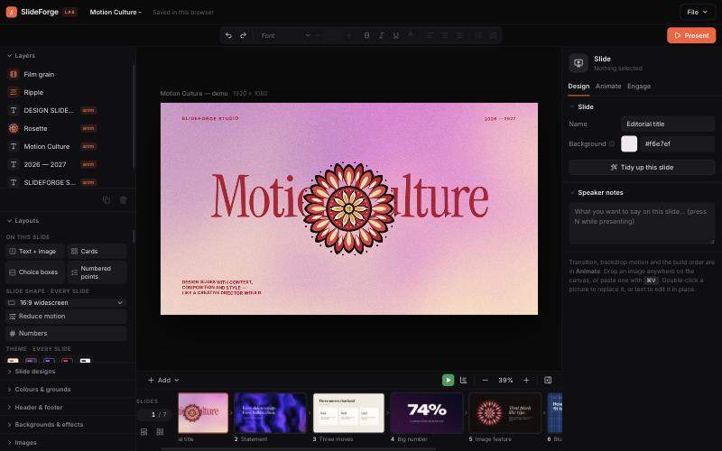
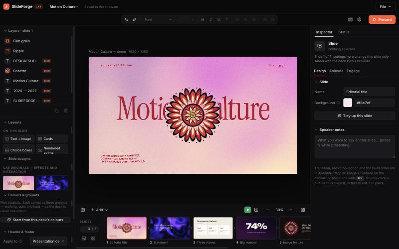
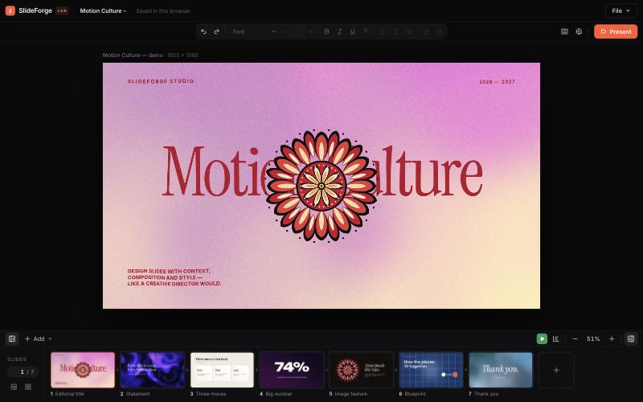
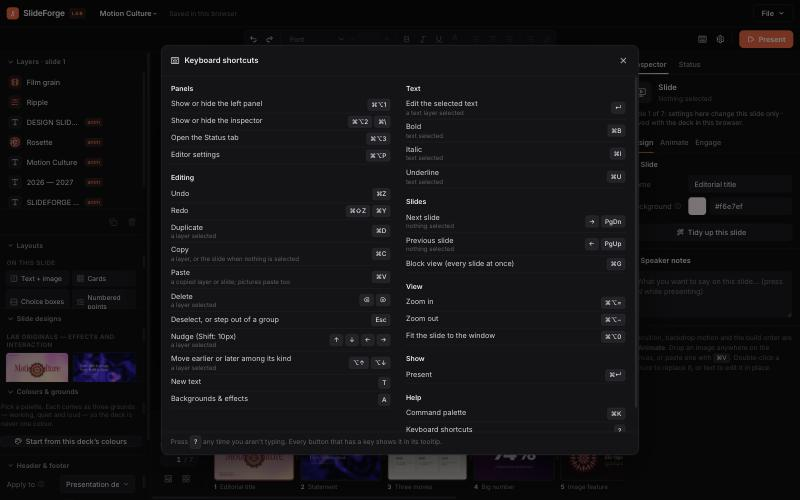
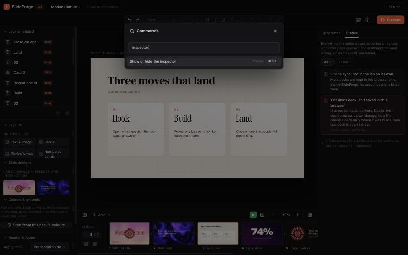
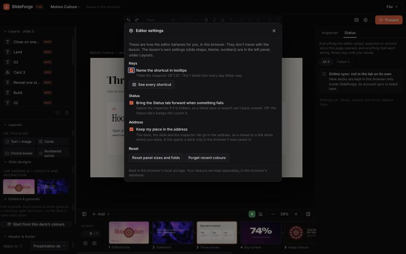
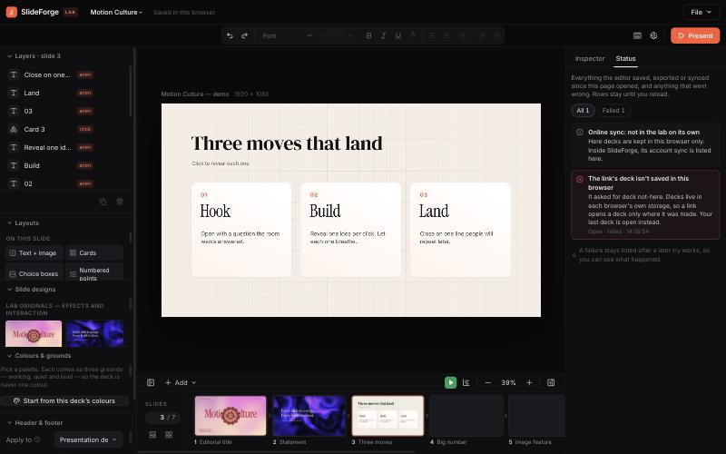
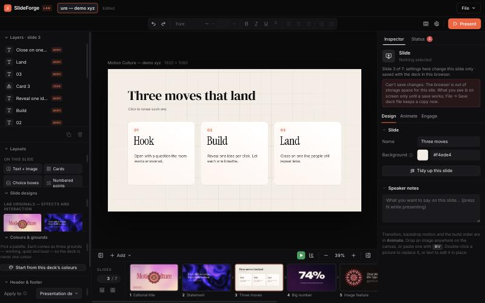

# The editor shell — before and after

Written 2026-10-25. The Lesson studio editor (`lab/`) took its frame from Remotion Studio's: one fixed layout, sides
that fold away, the place kept in the address, one status centre, an honest inspector, one list of keys, and one
settings place. It is about structure, not media: SlideForge still makes teaching decks, not video.

| | Before | After |
|---|---|---|
| **Shell** | The inspector folded away from a button, with no key. The left panel didn't fold. | Both sides fold, from a button at each end of the canvas bar or **⌘⌥1** / **⌘⌥2** (⌘\\ too). Each stays as you left it after a reload. The stage stays in the middle. |
| **Address** | The editor's address never changed; a reload went to the last slide, on the Design tab. | `#deck=…&slide=…&tab=…` (and `side=status`) follows you, so a reload or a link lands in the same place. `slide=4` works as a number too. A link to a deck this browser doesn't have says so in Status. |
| **Status** | Saves, exports and errors were toasts, gone in two seconds. A failed restore was silent. | A **Status** tab beside the Inspector lists every save, export, file opened, sync pass (inside SlideForge), toast and uncaught error, until reload. A red badge counts failures you haven't seen; a new failure brings the tab forward (Settings can turn that off). |
| **Inspector** | It said what was selected, not where it was kept. | Under the head: "Slide 3 of 7: settings here change this slide only · saved with the deck in this browser." When a save fails it says **Can't save changes:** with the reason, and how to keep a copy. It also says when a layer is locked or hidden, or the slide is hidden from the show. The Layers heading names its slide. |
| **Keys** | Keys were written into the handler, a few tooltips and `lab/README.md`, separately. There was no `?` sheet, and no ⌘K outside SlideForge. | One registry (`lab/src/keys/`) drives the handler in `app/App.tsx`, the tooltips and `aria-keyshortcuts`, the `?` sheet and the ⌘K palette. Inside SlideForge, its own ⌘K palette lists the lab's commands too. |
| **Settings** | No editor settings: only the lesson's own (Layouts → slide shape, theme). | A gear (**⌘⌥P**) opens the editor's own settings. They're kept in this browser and are separate from the lesson's: key hints in tooltips, bring Status forward on failure, keep my place in the address, reset panel sizes, forget recent colours. If the browser refuses storage, it says so beside the setting. |

## Before and after

Before: no side toggle on the left, no Status, no gear, nothing in the address.

After: the left-panel button at the start of the canvas bar, Inspector / Status at the top right, ? and the gear beside
Present, and the "what and where" line under the inspector's head.

Both sides folded (⌘⌥1, ⌘⌥2):

The `?` sheet, read from the registry:

⌘K, the same commands and the same handlers:

Editor settings, apart from the lesson's:

A link to a deck this browser doesn't have, said in Status rather than ignored:

A save the browser refused (storage full, simulated). The inspector says so inline and Status counts it:

## Where it lives

- `lab/src/keys/index.ts`: the shortcut registry. It is pure, so `ui/` and `app/` can both read it. `is(id, e)` matches
  a key, `tip()` and `keyProps()` write tooltips and `aria-keyshortcuts`.
- `lab/src/shell/`: the status centre (`status.ts`: `report`, `settle`, `track`), the address (`url.ts`, `place.ts`),
  editor preferences (`prefs.ts`), the palette's commands (`commands.ts`, `rank.ts`), the sheets (`Overlays.tsx`), the
  right column (`RightColumn.tsx`) and SlideForge's sync (`sync.ts`).
- `lab/src/app/App.tsx`: the key handler, now written as `is('…', e)`, binds the same handlers into the palette.
- `js/lab-engine.js`: the workspace's `commands()` gives SlideForge's ⌘K the lab's list.

To add a key: add a row to `SHORTCUTS`, handle it in `App.tsx` with `is()`, and bind it in `bindCommands` if the palette
should offer it. To list a job in Status: wrap it in `track('export', 'What it is', work)`.

## Limits

- Checked in `npm run dev` (the lab on its own) and by `lab/tests/shell-keys.test.ts`. Inside SlideForge (`lab-app/`,
  not rebuilt here) it is not yet checked in a browser. There, the address is the shell page's, and only the slide and
  tab are restored; the Library chooses the lesson.
- The video export (`ui/panels/VideoExport.tsx`) doesn't report to Status yet: it belongs to the MP4 session. It needs
  one `track('export', …)` around its render.
- ⌘⌥ keys are matched by the physical key (`e.code`), because ⌥ changes the character on a Mac.
